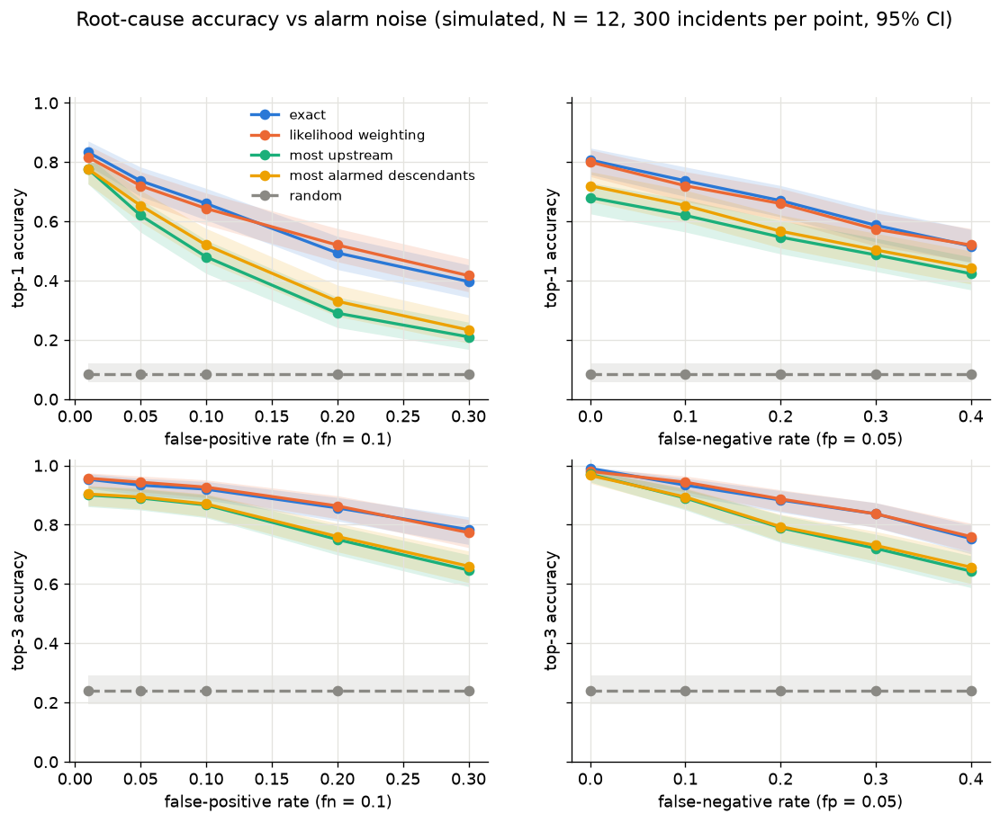
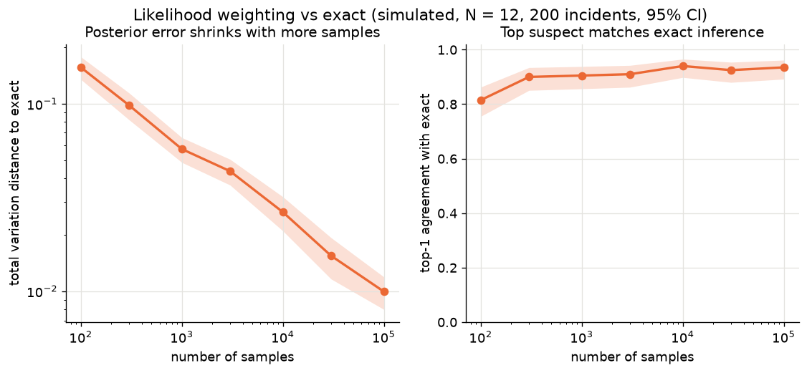
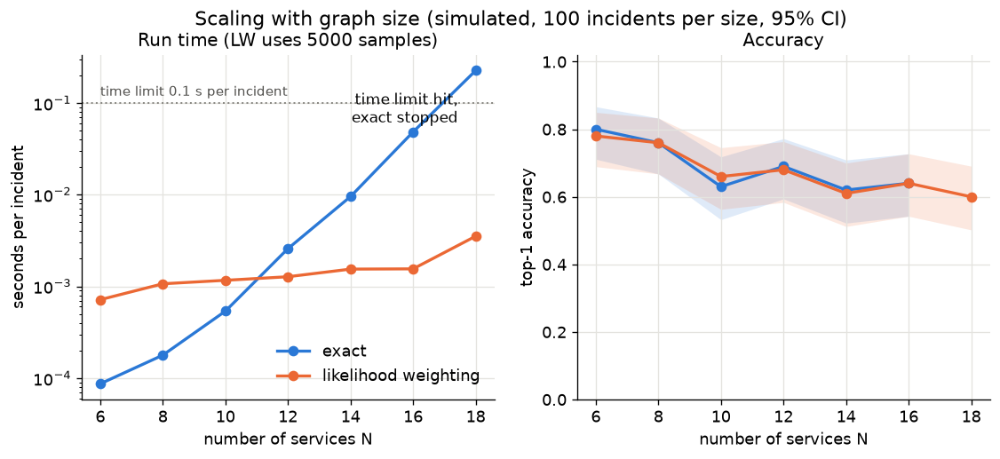
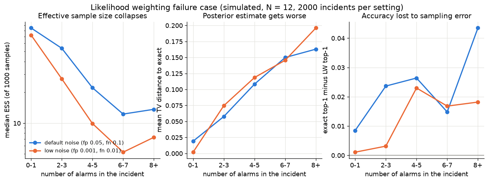

# Root-Cause Diagnosis with a Bayesian Network

COMP 560 (Artificial Intelligence) final project.

| Team member | PID |
|---|---|
| Dipendra Kandle | _PID_ |
| Aarav Tiwari | _PID_ |
| Ayug Poudel | _PID_ |

## Deliverables

| Deliverable | Location |
|---|---|
| Paper, compiled PDF (4 pages, conference style) | [`paper/paper.pdf`](paper/paper.pdf) |
| Paper, LaTeX source | [`paper/`](paper/) (`paper.tex`, style file, figures, `references.bib`) |
| Presentation slides (5 minutes) | [`slides/slides.pdf`](slides/slides.pdf) |
| Demo recording | _link or `slides/demo.mp4`_ |
| Source code | [`diagnose/`](diagnose/), [`experiments/`](experiments/), [`app.py`](app.py) |
| Results (CSVs and figures in the paper) | [`results/`](results/) |

## Summary

When one service in a software system fails, the services that depend on it
often fail too, and the monitoring system raises a burst of alarms. Some alarms
are false, and some real failures raise no alarm at all. We model this as a
Bayesian network and ask:

> Given the alarms, can Bayesian inference identify the root cause more
> accurately than simple heuristics, and how do exact inference and
> sampling-based approximate inference compare in accuracy and run time as the
> graph and the noise level grow?

**Main findings (simulated data):**

1. Bayesian inference beats both heuristic baselines at every noise level we
   tried. At default noise, exact inference gets 0.74 top-1 accuracy vs 0.65
   for the best heuristic; at a 30 percent false-alarm rate the gap grows to
   0.40 vs 0.23.
2. Likelihood weighting matches exact inference in accuracy, and its error
   shrinks roughly as 1 / sqrt(samples).
3. Exact inference by enumeration grows as 2^N and hits our 0.1 s per
   incident limit at N = 18 services; likelihood weighting stays near a few
   milliseconds.
4. Likelihood weighting breaks down when there are many alarms and very little
   noise: its effective sample size collapses (72 down to about 7 out of
   1,000) and its posterior drifts away from the exact one.

There is no model training and no external dataset. Every probability is set
by hand, and all data is simulated from the model itself.

### The model

- A random directed acyclic graph of N services (default 12). An edge
  `j -> i` means service `i` depends on `j`, so a failure can flow from `j` to
  `i`. Each node has 0 to 3 parents, and nodes are numbered in topological
  order.
- Hidden root cause `R`, uniform over the N services (one fault at a time).
- Failure `F_i`: the root always fails. Any other service fails with
  probability `1 - (1 - leak) * (1 - p_prop) ^ (number of failed parents)`
  (a noisy-OR with a small spontaneous leak). Defaults: `p_prop = 0.7`,
  `leak = 0.01`.
- Alarm `A_i`: `P(A_i = 1 | F_i = 1) = 1 - fn_rate`,
  `P(A_i = 1 | F_i = 0) = fp_rate`. Defaults: `fn_rate = 0.1`, `fp_rate = 0.05`.
- Query: the posterior `P(R = r | A)` for every service `r`.

### The methods

1. **Exact inference** (`diagnose/exact.py`): for each candidate root `r`, sum
   `P(F | R = r) * P(A | F)` over all `2^N` failure configurations, listed as
   rows of a numpy matrix, then normalize over `r`.
2. **Likelihood weighting** (`diagnose/sampling.py`): draw `R` uniformly,
   simulate the failure cascade forward, and weight each sample by
   `P(A observed | F)`. The posterior is each root's share of the total weight.
   We also report the effective sample size `(sum w)^2 / sum w^2`.
3. **Baselines** (`diagnose/baselines.py`): (a) the most upstream alarmed
   service, (b) the alarmed service with the most alarmed descendants,
   (c) a random ranking (chance level).

Each method returns a full ranking of suspects. We score top-1 and top-3
accuracy against the injected root cause.

## Setup

Requires Python 3.11 or newer (tested on 3.11 and 3.14, macOS). No GPU,
network access, API keys, datasets or pretrained models are needed.

```bash
git clone https://github.com/dipendrak/incident-detective.git
cd incident-detective
python3 -m venv .venv
source .venv/bin/activate        # Windows: .venv\Scripts\activate
pip install -r requirements.txt
```

## Reproducing the results

Run every command from the repository root.

| What | Command | Time (Apple Silicon laptop) |
|---|---|---|
| Run the tests | `python -m pytest -q` | about 6 s |
| **Reproduce every result in the paper** | `python experiments/run_all.py` | about 35 s |
| Quick smoke run (fewer incidents) | `python experiments/run_all.py --quick` | about 7 s |
| One experiment only | `python experiments/<name>.py` (add `--quick` if wanted) | 5 to 10 s each |
| Launch the interactive demo | `streamlit run app.py` | opens at http://localhost:8501 |

`run_all.py` overwrites the CSVs and figures in `results/`. Add `--out DIR` to
write somewhere else instead (the tests do this).

Every script uses fixed seeds (base seed 560), so a rerun gives exactly the
same CSVs, figures and numbers. The only exception is run time in the scaling
experiment, which depends on the machine.

| Paper result | Script | Output files |
|---|---|---|
| Accuracy vs noise (Experiment 1) | `experiments/accuracy_vs_noise.py` | `results/accuracy_vs_noise.{csv,png}` |
| Sampling convergence (Experiment 2) | `experiments/sampling_convergence.py` | `results/sampling_convergence.{csv,png}` |
| Scaling with graph size (Experiment 3) | `experiments/scaling.py` | `results/scaling.{csv,png}` |
| Likelihood weighting failure case (Experiment 4) | `experiments/failure_case.py` | `results/failure_case.{csv,png,txt}` |

### Using the demo

The sidebar sets the graph size, propagation probability, false-alarm and
missed-alarm rates, the number of samples, and a seed. **Inject random
failure** breaks a random service; **Choose root cause** breaks the service
picked in the dropdown. The page shows the graph (gray healthy, red failed,
bold outline means an alarm went off), the exact and likelihood-weighting
posteriors side by side with the true root marked, and what each method
blamed. Raising the noise sliders flattens the posterior.

## Repository layout

```
diagnose/                   core library
  graph.py                  random DAG generator, layers, descendants
  model.py                  parameters, noisy-OR failure model, alarm model, forward sampling
  exact.py                  exact inference by enumeration
  sampling.py               likelihood weighting with effective sample size
  baselines.py              three heuristic baselines
  simulate.py               simulate_incident: inject a fault, cascade it, raise alarms
  metrics.py                rankings, top-k, total variation, confidence intervals
experiments/
  accuracy_vs_noise.py      Experiment 1
  sampling_convergence.py   Experiment 2
  scaling.py                Experiment 3
  failure_case.py           Experiment 4
  run_all.py                runs all four (supports --quick and --out)
  common.py                 shared helpers, plot style, command-line options
tests/test_diagnose.py      pytest suite
app.py                      Streamlit demo
results/                    CSVs, figures and failure_case.txt produced by run_all.py
paper/                      LaTeX source and compiled PDF of the report
slides/                     presentation slides (and demo recording)
```

## Results

All numbers come from `python experiments/run_all.py` on simulated data. 95
percent confidence intervals are in parentheses: Wilson intervals for
accuracies, normal intervals for means. Experiments 1, 2 and 4 draw a new random
graph for each incident (graph seed `560 + k` for incident `k`), so results are
averaged over graph shapes as well as over incidents.

### 1. Accuracy vs noise

N = 12, 300 incidents per setting, likelihood weighting with 5,000 samples.
At default noise (fp 0.05, fn 0.1):

| Method | Top-1 | Top-3 |
|---|---|---|
| Exact inference | 0.74 (0.68 to 0.78) | 0.93 (0.90 to 0.96) |
| Likelihood weighting | 0.72 (0.67 to 0.77) | 0.94 (0.91 to 0.96) |
| Most upstream alarm | 0.62 (0.56 to 0.67) | 0.89 (0.85 to 0.92) |
| Most alarmed descendants | 0.65 (0.60 to 0.70) | 0.89 (0.85 to 0.92) |
| Random | 0.08 (0.06 to 0.12) | 0.24 (0.20 to 0.29) |

The Bayesian methods beat both heuristics at every noise level we tried, on
both top-1 and top-3. The top-1 gap grows with the false-positive rate (from
0.06 at fp 0.01 to 0.16 at fp 0.3) and stays near 0.07 to 0.10 across the
false-negative sweep. Heuristics trust every alarm, so a single false alarm
upstream fools "most upstream". The posterior instead weighs how likely each
alarm pattern is under each candidate root. With low noise (fp 0.01) all
non-random methods are close (0.83 exact vs 0.78 heuristics). Exact and
likelihood weighting are within sampling noise of each other throughout.



### 2. Sampling convergence

N = 12, default noise, 200 incidents.

| Samples | 100 | 1,000 | 10,000 | 100,000 |
|---|---|---|---|---|
| Total variation to exact | 0.156 | 0.057 | 0.026 | 0.010 |
| Top-1 agreement with exact | 0.82 | 0.91 | 0.94 | 0.94 |
| Mean effective sample size | 9 | 65 | 557 | 5,446 |

The error falls roughly as one over the square root of the number of samples
(a straight line on the log-log plot). Top-1 agreement levels off near 0.93.
Every disagreement at 100,000 samples is a near-tie in the exact posterior (top
two suspects within about 0.001, often two services the alarms cannot tell
apart), so it barely matters for accuracy. The effective sample size is only
about 5 percent of the raw sample count.



### 3. Scaling

100 incidents per graph size, likelihood weighting with 5,000 samples. Exact
inference is stopped once its mean time per incident exceeds 0.1 s.

| N | 6 | 10 | 12 | 14 | 16 | 18 |
|---|---|---|---|---|---|---|
| Exact, ms per incident | 0.1 | 0.5 | 2.6 | 9.5 | 48 | 225 (stopped) |
| Likelihood weighting, ms | 0.7 | 1.2 | 1.3 | 1.5 | 1.6 | 3.5 |

For N of 12 and above, exact time grows about 4 to 5 times for every 2
services added (the `2^N` enumeration). It becomes slower than likelihood
weighting between N = 10 and N = 12 and hits the time limit at N = 18.
Likelihood weighting grows only linearly in N. Top-1 accuracy is the same for
both wherever exact finishes (0.64 vs 0.64 at N = 16).



### 4. Failure case for likelihood weighting

N = 12, 2,000 incidents per setting, 1,000 samples. In the low-noise setting
(fp 0.001, fn 0.01), the median effective sample size drops from 72 with 0 to 1
alarms to about 7 with 8 or more alarms, and the total variation distance to
exact grows from 0.002 to 0.196. Likelihood weighting proposes failures from
the prior without looking at the alarms. Each sample that disagrees with an
alarm pays a factor of fp or fn in its weight, so with many alarms a few lucky
samples carry almost all the weight. Exact inference on the same evidence is
unaffected. See `results/failure_case.txt` for the full explanation.



## Limitations

- **Single root cause.** The model assumes exactly one fault per incident.
  Real outages can have several independent causes at once.
- **Synthetic graphs and data.** Graphs are random DAGs with at most 3 parents
  per node, not real service topologies, and all incidents are simulated from
  the same model used for inference. Real systems may have hubs, cycles
  (retries, mutual dependencies), or hundreds of services.
- **Known noise rates.** Inference uses the true `p_prop`, `leak`, `fp_rate` and
  `fn_rate`. In practice they would have to be estimated, and a wrong value
  could hurt the Bayesian methods, which rely on them, while the heuristics do
  not use them at all.
- **Independent alarms.** Alarms depend only on their own service's state.
  Real alarms are often correlated (shared monitoring, alarm storms).
- **Exact inference by brute force.** We enumerate all `2^N` states on purpose
  to show the cost. Variable elimination or junction trees could exploit graph
  structure and push the limit higher.
- **Run times** depend on the machine and are the only non-reproducible
  numbers.

## Credits

- All code was written for this project. It uses only the open-source
  libraries numpy, matplotlib, streamlit and pytest. No outside code, data or
  pretrained models were used.
- Bayesian networks, noisy-OR, enumeration and likelihood weighting follow
  S. Russell and P. Norvig, *Artificial Intelligence: A Modern Approach*, 4th
  ed., Chapters 13 and 14.
- Effective sample size: A. Kong, "A note on importance sampling using
  standardized weights," University of Chicago technical report, 1992.
- Wilson score interval: E. B. Wilson, "Probable inference, the law of
  succession, and statistical inference," *JASA*, 1927.
- Code was written with help from Claude (Anthropic) as an AI coding assistant.
